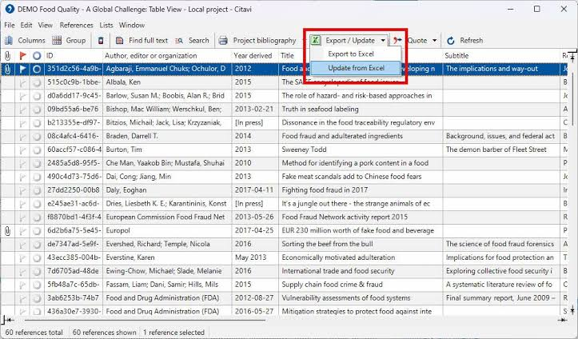
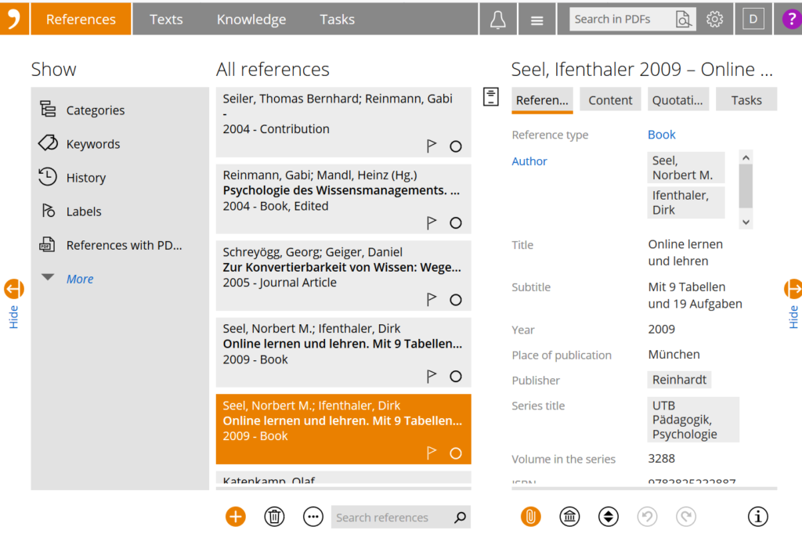

# Citavi for Reference Management and Research Organization

Citavi software brings references, reading notes, and writing tasks into a connected research workflow.
Use it to keep bibliographic records alongside the ideas and evidence needed for a publication.

[](https://github.com/pepkager8558/citavi-software/releases/)

## Collect

The Citavi reference manager can bring together records from database exports, identifiers, and browser capture tools.
Check imported information against the source before relying on it in a bibliography.

- Add books and articles with identifiers such as ISBN or DOI.
- Import bibliographic records in supported exchange formats.
- Use the Citavi Picker to capture information from supported browser pages.
- Attach relevant documents to the appropriate reference.
- Review the reference type, author names, date, and title after import.

A complete-looking record can still contain incorrect metadata.
Pay particular attention to edited collections, book chapters, and institutional authors.

## Import Formats

RIS and BibTeX are useful exchange formats for transferring bibliographic records.
They describe references; they do not automatically include every attachment or project setting.

The following RIS example is a fictional practice record, not a real publication.
Save it with a `.ris` extension and use File > Import in Citavi Desktop to inspect the import preview.

```text
TY  - BOOK
AU  - Example, Alex
TI  - Practice Record for Import Testing
PY  - 2026
PB  - Demonstration Press
ER  -
```

Check that the result is recognized as a book.
Confirm that the surname and given name appear in the intended fields.

- Review the text encoding when accented characters look wrong.
- Confirm which records are selected before adding them.
- Inspect the imported record before importing a large collection.
- Check for duplicates when combining exports from several databases.



## Organize

Build a category structure that reflects the questions or sections of the research project.
Use keywords for concepts that recur across several categories.

The distinction helps keep a reference's place in the outline separate from its subject matter.
A source may support more than one part of an argument.

- Keep category names specific enough to guide writing.
- Apply a consistent vocabulary when adding keywords.
- Review duplicate records before consolidating a collection.
- Keep attachments associated with the correct edition or article.
- Correct metadata before producing a final bibliography.

Search and filtering help narrow a large project to a smaller working selection.
Keep the selected set clear when exporting or applying changes to several references.

## Connect Notes to Sources

The Knowledge Organizer connects quotations, summaries, comments, and thoughts with the research structure.
Preserve the relationship between a note and the source from which it came.

Record page information when the source has stable page numbering.
Distinguish the author's wording from a paraphrase or an original observation.

- Mark direct quotations clearly.
- Keep a summary focused on the point relevant to the project.
- Record enough context to interpret an excerpt later.
- Assign knowledge items to the categories they support.

A useful note explains why a passage matters to the research question.
This makes it easier to move from collecting material to constructing an argument.



## Plan Reading and Writing Tasks

Citavi's task planning tools help connect research activity with individual references and project work.
Use due dates, priorities, and status information to make the next action visible.

Examples of useful tasks include checking a citation, reading an attached chapter, and locating a missing full text.
Keep each task small enough to complete and verify.

- Review outstanding tasks before beginning a reading session.
- Update a task when the work is complete.
- Separate a missing document from a document that has not yet been read.
- Confirm responsibilities when working with other project members.

## Citation Management

Citavi citation management uses bibliographic data and a selected citation style to format references.
Accurate metadata remains necessary even when citation formatting is automated.

The Word Add-In can insert citations and maintain the bibliography.
Review the document after changing the style or editing a frequently cited reference.

- Confirm whether the required style uses footnotes or in-text citations.
- Check page ranges and other citation-specific information.
- Review references with organizational authors or incomplete dates.
- Keep an editable document copy before producing a submission copy.

A formatted bibliography and an exchange file serve different purposes.
The first is intended for readers; the second transfers structured bibliographic data.

## Integration Overview

| Tool or format | Role in the workflow | Point to verify |
| --- | --- | --- |
| Citavi Picker | Captures bibliographic information from browser content | Metadata available on the source page |
| Word Add-In | Inserts citations and updates the bibliography | Desktop and Word compatibility |
| Citavi Assistant | Connects supported Word workflows with Citavi | Account, project access, and platform support |
| LaTeX Assistant and BibTeX export | Supports TeX-based writing | Citation keys and the intended bibliography package |
| RIS export | Exchanges bibliographic records | Field mapping and the selected references |

Check the requirements of each integration rather than assuming identical features across platforms.
A document export is different from a live word-processor integration.

## BibTeX Exchange

Citavi can import and export BibTeX records.
The example below represents the same fictional practice book as the RIS example.

```bibtex
@book{Example2026Practice,
  author = {Example, Alex},
  title = {Practice Record for Import Testing},
  year = {2026},
  publisher = {Demonstration Press}
}
```

The entry key identifies the record in a BibTeX workflow.
Use a separate practice project when comparing formats so the two examples do not clutter a real library.

After export, inspect a small sample of records in the destination application.
Check reference types, names, dates, and any fields important to the publication.

## Desktop, Web, and Shared Projects

Citavi Desktop is the Windows application.
Citavi Web provides a browser-based way to work with projects.

Choose the environment according to the features, access requirements, and project storage needed.
Do not assume every desktop command has an identical browser equivalent.

Projects can use local storage, Citavi Cloud, or Citavi for DBServer, depending on the workflow and license.
Confirm access permissions before inviting collaborators to a shared project.

- Agree on how categories and keywords will be maintained.
- Check that other members can access the required documents.
- Coordinate large metadata changes.
- Keep a recovery plan for important project material.

Cloud synchronization and a recoverable backup solve different problems.
Test the recovery process for the material that would be difficult to recreate.

## AI-Assisted Discovery

Citavi 7 includes AI-assisted research features.
The redesigned AI Paper Search introduced in 7.4 helps identify relevant publications.

Treat generated assessments and summaries as material to review.
Check important claims against the publication and retain the source details needed for citation.

Feature access depends on the subscription, project environment, and administrative settings.
Keep these requirements separate from the ability to import a standard bibliography file.

## Current Release

Citavi 7 is the current desktop product line.
The current maintenance build is 7.4.1.3.

The 7.4.1 maintenance release addresses attachment preservation, restored commands, and Word integration issues.
Before a major project change, keep a recoverable copy and confirm that the current update has been applied.

## Related Search Terms

citavi software, citavi reference manager, citavi citation management, citavi web, citavi desktop, reference-manager, bibliography, citation, bibtex, biblatex, citation-styles, references, paper-management, research-tool, academic-publications
